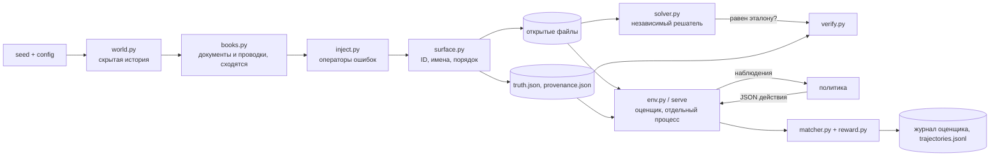

# AuditGym — SPEC

> **Исторический документ.** Это план от 19.11.2026, по которому начиналась работа; часть путей, команд и размеров в нём устарела (например, команд `auditgym generate` и `auditgym verify` нет — есть `python3 -m auditgym check` и `serve`). Актуальное поведение описывают `README.md`, `docs/CONTRACTS.md` (контракт) и `docs/DESIGN.md` (записка о дизайне); при расхождении верны они.

**Кейс:** Genesis Hackathon, FinTech, «RL-среды для дообучения моделей финансового аудита». **Одной фразой:** воспроизводимая среда, где агент-аудитор через пять инструментов изучает синтетические книги компании и сдаёт выводы с доказательствами, а отдельный оценщик считает награду по опубликованным правилам.

Название рабочее. Статус: версия 2 от 19.11.2026 — после независимой критики (её решения собраны в разделе «Решения версии 2»). До ответа организаторов на вопросы из `BREAKDOWN.md` §4 действуем по самому строгому прочтению.

## Plan-note
- **Идея:** генератор сначала строит скрытую историю компании (контрагенты, счета, платежи, курсы), из неё выводит документы и проводки, которые сходятся. Потом применяет операторы ошибок и записывает каждое изменение в provenance. Эталон вычисляется из разницы «история → книги с ошибкой». Независимый решатель по одним открытым записям обязан найти ровно эталон, иначе эпизод бракуется.
- **Плюсы:** все 90 автоматических баллов превращаются в свойства, которые мы проверяем сами на тысячах seed до сдачи. Нет зависимостей, сети и моделей.
- **Минусы и риски:** не знаем проверочный скрипт организаторов; бухгалтерская модель упрощена; двое-четверо людей и 3,5 дня.

## Проблема заказчика
Чтобы дообучать модель-аудитора с подкреплением, нужна среда: много разных «компаний» с известными ошибками, узкий набор инструментов и награда, которую нельзя обмануть. Плохая среда учит модель трюкам: помечать всё подряд, угадывать по ID, писать убедительный текст. Организаторы оценивают именно это: корректность данных и оценщика.

## Решение
Python-пакет `auditgym` (только стандартная библиотека, Python 3.11):

- `auditgym generate` — создаёт эпизод по seed и конфигурации: открытые файлы и закрытые `truth.json`, `provenance.json`.
- `auditgym.Env` — контракт `reset(seed, config)` / `step(action)`. Это тонкий клиент: он сам запускает процесс-оценщик и говорит с ним JSON-строками. Эталон живёт только в памяти оценщика, поэтому политика в том же процессе, что и `Env`, не может его прочитать.
- `auditgym serve` — тот же оценщик для внешнего запуска (stdin/stdout). Режим `eval` включается только флагом запуска оценщика, а не через `config`.
- `Env.from_files(dir)` — загрузка эпизода из каталога: нужна, если организаторы сами переставляют строки и меняют ID в наших файлах.
- `auditgym.matcher`, `auditgym.reward` — чистые функции сопоставления и награды.
- `auditgym verify` — проверка эпизода: равенства до ошибки, расхождение после, достаточность доказательств.
- `policies/` — четыре базовые политики: случайный исследователь, простая сверка, «пометить всё», oracle.
- `python -m auditgym check` — единая команда: тесты, проверка 20 эпизодов, прогон политик, таблица измерений. `make check` — псевдоним (в базовом образе `make` нет).

## Путь проверяющего (2 минуты)
1. `git clone … && cd auditgym`
2. `docker build -t auditgym . && docker run --rm --network none auditgym` — видит «N из N проверок пройдено» и таблицу P, R, F1, возврата, шагов и времени для четырёх политик.
3. `make demo` — скриптовая политика проходит один эпизод: шаги, вывод, награда.
4. README, раздел «Как это устроено» — схема и ссылки на правила сопоставления и ограничения.

## Требования кейса → как закрываем
| Требование | Решение | Статус |
|---|---|---|
| R1 четыре типа ошибок | Операторы `duplicate_invoice`, `allocation_gap`, `fx_error`, `period_cutoff`, каждый включается и настраивается в `config.errors` | план |
| R2 два сценария взаимодействия | `I1`: частичный платёж в иностранной валюте на границе периода (allocation_gap + fx_error). `I2`: дубль счёта, копия которого отнесена не к тому периоду (duplicate_invoice + period_cutoff) | план |
| R3 чистые и отвлекающие случаи | `config.errors = {}` даёт чистую компанию; отвлекающие: разбитые платежи, возвраты, повторяющиеся суммы, операции у границы периода в другом часовом поясе, соседние даты с другим курсом | план |
| R4 история → ошибки с причиной | `world.py` → `books.py` → `inject.py`; каждое изменение пишется в provenance: оператор, параметры, записи до и после | план |
| R5 проверяемость по открытым записям | `solver.py`: независимый решатель без доступа к truth; эпизод принимается, только если решатель = эталон | план |
| R6–R7 форматы | Схемы в `schemas/`; деньги — целые; курсы — `Decimal` из строк; отсутствующие ссылки — `null` | план |
| R8–R13 контракт | `env.py`; тест на каждое предложение раздела 04 кейса | план |
| R14 изоляция | Оценщик в отдельном процессе; белый список полей наблюдения; ID назначаются после вставки ошибок; тест на утечки | план |
| R15–R18 выводы и награда | `matcher.py`, `reward.py`; тесты на атаки | план |
| R19–R20 воспроизводимость | Свой генератор случайных чисел; `seed` истории и `surface_seed` поверхности; тест метаморфизма | план |
| R21–R22 запуск | Dockerfile на `python:3.11-slim`, без установки пакетов из сети во время проверки; `make check` | план |

## Скоуп
- **MUST:** всё из таблицы выше; 10 train + 10 dev эпизодов; `trajectories.jsonl`; записка о дизайне; README; лицензия; тесты; таблица измерений; раздел ограничений.
- **SHOULD:** прогон проверки эпизодов на 10 000 seed в `make fuzz`; мутационные тесты matcher; адаптер HTTP на localhost, если организаторы вызывают среду так.
- **COULD:** обёртка `gymnasium.Env` отдельным файлом; экспериментальная награда рядом с общей; закупочная сторона (счета поставщиков) в дополнение к продажам.
- **WON'T:** обучение весов, локальная модель, UI, документы в виде PDF или «живого» текста, реальные данные.

## Архитектура

- **`rng.py`** — детерминированный генератор на SHA-256 со счётчиком. Не зависит от версии Python и от `PYTHONHASHSEED`. Отдельные потоки: история, ошибки, поверхность.
- **`world.py`** — история: компания (базовая валюта, часовой пояс, период), контрагенты, счета с позициями, платежи с распределением по счетам, возвраты, таблица курсов.
- **`books.py`** — из истории строит документы и двойную запись. Проводки ведутся в базовой валюте; документ в иностранной валюте пересчитывается по правилу из `policy.json` (дата курса, округление). Разница курсов при оплате идёт на отдельный счёт.
- **`inject.py`** — операторы ошибок меняют книги и пишут provenance. Эталон считается из разницы с правильными книгами.
- **`surface.py`** — после вставки назначает все ID, имена и порядок строк по `surface_seed`. Поэтому ID и порядок не несут информации о том, где ошибка, а смена `surface_seed` даёт тот же эпизод с другими ID.
- **`env.py`** — контракт и пять действий; `serve.py` — запуск в отдельном процессе.
- **`solver.py`** — решатель по открытым записям; он же сильная скриптовая политика для демо.

### Модель книг (минимальная)
- **План счетов фиксированный** и печатается в первом наблюдении: деньги, дебиторка, выручка, нераспределённые поступления, курсовые разницы, фоновые расходы.
- **Книга ведётся в базовой валюте** (`policy.json`: `ledger_currency: base`): только так неверный курс вообще виден. Документ в иностранной валюте пересчитывается по формуле `round(сумма_документа × 10^(e_base − e_src) × курс)` от итога документа, режим округления и разрядности валют — в `policy.json`. Дата курса берётся в часовом поясе компании.
- **Часовой пояс — фиксированное смещение** (`+05:00`), не имя зоны. Период — полуинтервал `[period_start, period_end)`.
- **Счёт клиенту:** Дт дебиторка / Кт выручка. **Платёж:** Дт деньги / Кт дебиторка. Валюта платежа всегда равна валюте счёта. Курсовая разница при оплате — отдельная строка; она считается от отражённых значений и ошибкой не является.
- **Платёж с несколькими ссылками гасит все свои счета полностью.** Частичный платёж ссылается ровно на один счёт. Иначе по `invoice_refs` без сумм нельзя сказать, сколько положено каждому счёту.
- **Возврат** — платёж с отрицательным `amount_minor` и ссылкой на счёт (вопрос организаторам задан).
- **Фоновые проводки** (расходы, зарплата) — сбалансированные пары без ссылок на документы. Они нужны, чтобы набрать 200–2 000 строк при 20–200 документах, и не трогают дебиторку и нераспределённые.
- **Группа проводок** (в `ledger.csv` нет своего поля): по `payment_id`, если он не `null`; иначе по `invoice_id`; у фоновых — пара с одинаковыми `timestamp` и `entity_id`. Колонки в CSV не добавляем.
- **В книге только строки периода.** Документы соседнего периода без проводок — законный отвлекающий случай.
- **Курсы и названия синтетические.** В `fx.csv` только направление «иностранная → базовая», без пропусков дат.

Равенства, которые проверяет `verify` на книгах до вставки ошибок:
1. Дебет равен кредиту по всей книге, по валюте и по каждой группе проводок.
2. У каждой строки заполнена ровно одна сторона, суммы неотрицательные целые.
3. Все ссылки существуют или равны `null`; итог счёта равен сумме позиций; на каждую нужную дату и пару есть курс; счётчики manifest совпадают с файлами.
4. Каждый документ со ссылкой из книги отражён ровно одной группой на свою сумму в базовой валюте по курсу из политики.
5. Остаток дебиторки по каждому счёту равен «сумма счёта − оплаты + возвраты»; на нераспределённых остаток есть только у переплат и авансов.
6. Каждая проводка со ссылкой на документ относится к документу, дата которого в поясе компании попадает в период.

В закрытый каталог кладём полный снимок книг до вставки с финальными ID: «состояние до ошибки» должно проверяться без нашего кода.

### Определения ошибок (публикуются в записке о дизайне)
Каждая ошибка — **предикат над итоговыми открытыми записями**, а не разница с историей. Эталон — множество срабатываний предикатов; provenance служит перекрёстной проверкой «внесённое равно найденному».

| Тип | Предикат | `affected_ids` (множество `doc_id`) | Сумма и валюта | Допустимые наборы доказательств |
|---|---|---|---|---|
| `duplicate_invoice` | Два счёта с разными `doc_id` и `invoice_id`, у которых совпадают контрагент, валюта, итог и позиции (как мультимножество, включая поля периода услуги), и оба отражены в книге. `issued_at` в определение не входит | оба счёта | `total_minor`, валюта счёта | оба `doc_id` и по одной строке (Дт дебиторки или Кт выручки) каждого счёта: четыре набора |
| `allocation_gap` | У платежа P есть строка на нераспределённых с `payment_id = P`; документ P ссылается на счёт X; у X после всех проводок остаток дебиторки больше нуля | платёж и счёт | `credit_minor` строки на нераспределённых, базовая валюта (читается из записи, без обратного пересчёта) | платёж, счёт, `row_id` строки на нераспределённых, строка Дт дебиторки счёта и строка Кт дебиторки платежа по этому счёту (пять ID) |
| `fx_error` | Строка книги, которая по политике равна «сумма документа × курс» (у счёта пара Дт/Кт, у платежа строка денег), отличается от правильного значения больше допуска | документ | модуль разницы, базовая валюта | документ, `row_id` строки пересчёта (Дт или Кт счёта, деньги платежа) и ключ курса `дата|из|в` — обязательно, без него вывод FP |
| `period_cutoff` | Документ датирован вне периода в поясе компании (`issued_at` у счёта, `timestamp` у платежа), а его проводка стоит в книге периода. Только это направление | документ | `total_minor` или `amount_minor`, валюта документа | документ и `row_id` дебетовой строки; либо документ и `row_id` кредитовой |

- **Правила ответа агенту:** всё, что в таблице выше сказано про `affected_ids`, сумму, валюту и наборы доказательств, агент получает в первом наблюдении в `task.answer_rules` (`docs/DECISIONS.md`, раздел L); правила нельзя пропустить, иначе правильная находка без ключа курса или строки дебиторки была бы FP.
- **Допуски** — фиксированные целые в `policy.json`: ноль для трёх типов, для `fx_error` одна минимальная единица. Оператор `fx_error` обязан дать разницу не меньше порога (≥ 100 минимальных единиц и ≥ 0,5 %), иначе выходные с тем же курсом дали бы «ошибку» с суммой ноль.
- **Запреты генератора:** одна копия на оригинал; нет двух законных счетов с одинаковыми контрагентом, валютой, итогом и позициями, кроме ловушки A — непроведённой копии, повторно отправленной после периода (`docs/DECISIONS.md` K); не больше одного разрыва на платёж; нет последующих платежей и возвратов по счёту с разрывом; нет пары «возврат + такой же повторный счёт».
- **Отвлекающие случаи,** которые обязаны остаться чистыми: переплата (остаток законно висит, счёт закрыт), аванс без ссылок, законная частичная оплата, разбитый платёж, возврат, повторяющаяся сумма с другим периодом услуги, документ у границы периода в другом смещении, курс соседнего дня, выходные; ловушки против трюков (`docs/DECISIONS.md` K): непроведённая копия счёта после периода и счёт периода за услугу соседнего периода.
- **Взаимодействия:** `I1` — частичный платёж в иностранной валюте у границы периода (`allocation_gap` + `fx_error` на одном платеже); `I2` — копия счёта, датированная вне периода, но отражённая в нём (`duplicate_invoice` + `period_cutoff`). В эталоне по две записи; суммы не зависят от порядка вставки, потому что каждая читается из итоговых записей.
- **Независимые потоки случайности** на каждый оператор: включение одного типа не сдвигает место другого.

### Схема `config`
Публикуется в `schemas/config.json`, параметров мало: размеры (диапазоны), число ошибок по типам, `interaction: none | I1 | I2`, отвлекающие случаи, валюты из поддерживаемого списка, смещение пояса, `surface_seed`. Невалидное сочетание — понятная ошибка `reset`, а не мусорные данные. Лимиты валидации: ошибок ≤ 30; ошибок ≤ документов / 8 (иначе «пометить всё» может выйти в плюс); страниц на полное чтение ≤ 60; проводок ≤ 2 000.

**`reset` обязан вернуть корректный эпизод для любого seed и любой валидной конфигурации.** Внутри — детерминированный перебор (seed, попытка 0..N) с проверкой решателем; цель — корректность по построению, перебор только страховка. Доля повторов по причинам идёт в таблицу измерений.

Размер по умолчанию: 400–800 проводок, 40–100 документов, 1–2 валюты, месяц. Полное чтение — 12–20 страниц, потолок награды около 0,96. Максимум из кейса (2 000 строк, 200 документов) читается за 51 страницу.

### Контракт: что фиксируем
- **Действие:** `{"action": "<имя>", ...аргументы}`. Парсер также принимает ключ имени `tool`, `name`, `type` и аргументы в `args`, `arguments`, `params`: политики организаторов могут слать иначе.
- **Таблицы:** `ledger`, `invoices`, `payments`, `fx`. ID курса — составной ключ `дата|из|в`.
- **Первое наблюдение:** задача, перечень типов ошибок, схема findings, лимиты, допуски, план счетов, полная политика, manifest, остаток шагов. Дальше — только запрошенные записи, `next_cursor`, результат или ошибка, `steps_remaining`. Ни времени, ни счётчиков, ни эха seed и конфигурации.
- **manifest:** фактические счётчики после вставки ошибок; `episode_id` — хэш без seed; в открытом manifest только версия открытой части конфигурации.
- **`list_records` отдаёт полные записи** вместе с позициями счёта; `limit > 50` обрезается до 50; курсор — непрозрачная строка; чужой или битый курсор — ошибка с расходом шага.
- **Ошибки** — фиксированные коды без текста исключений и путей. Несуществующий ID неотличим от любого другого неизвестного.
- **Калькулятор:** `+ − * /`, скобки, унарный минус, десятичные литералы; без степеней, имён и экспоненциальной записи; длина ≤ 200 символов; `Decimal` с фиксированной точностью.
- **Режимы:** по умолчанию `train` — терминальная награда возвращается; в `info` только награда и P, R, F1, без вердиктов по отдельным выводам. В `eval` политике возвращается 0, а результаты пишутся в `results.jsonl` по пути, заданному при запуске оценщика.
- **После конца и до `reset`:** `step` возвращает фиксированную ошибку, награда 0, состояние и журнал не меняются.
- **Усечение:** лимит шагов даёт `truncated=true`, пустой список выводов и `inspection_steps = 100`; лимит времени — то же, но `inspection_steps` равен числу действий, сделанных на самом деле. Сотый шаг `submit` — это `terminated`. Часы есть только у оценщика и подменяются в тестах; время не попадает в наблюдения, `info` и траектории.

### Сопоставление и награда
- **Неверная структура → награда −1:** больше 30 выводов, больше 10 элементов в `evidence_ids` (по сырому списку), больше 1 000 символов объяснения (по кодовым точкам), `type` не строка, чужой `episode_id`, сумма не целое число (включая `true`, `100.5`, `"100"`), отрицательная сумма, NaN, сообщение больше 256 КиБ, нет обязательного поля. `explanation` необязателен; сумма только JSON-целое (`125000.0` — неверная структура); `type`, `currency` и ID сравниваются точно; `affected_ids` и `evidence_ids` — множества (повторы ID внутри списка схлопываются, лимит 10 — по сырому списку). Лишние ключи игнорируются (официальные определения 20.11, DECISIONS R). Полный список — `docs/CONTRACTS.md` §5.
- **FP, а не −1:** неизвестная строка `type`, несуществующий или недоступный ID в доказательствах, неверная валюта, неверная сумма, не тот тип.
- Вывод совпадает с записью эталона, если совпали тип, множество `affected_ids`, валюта, сумма в допуске, все `evidence_ids` существуют в эпизоде и среди них есть хотя бы один полный допустимый набор. Лишние существующие ID в доказательствах разрешены (правило вынесено в один параметр; вопрос организаторам задан).
- При канонических `affected_ids` вывод подходит не более чем к одной записи эталона, но сопоставление всё равно строится как максимальное паросочетание один к одному: TP, FP и FN не зависят от порядка выводов, даже если в эталоне два элемента с одним ключом. Повторные и лишние выводы — FP, несопоставленные записи эталона — FN.
- F1 и формула награды — дословно из кейса, включая пустые случаи. `inspection_steps` — число шагов до `submit`, включая шаги с ошибкой.
- Текст `explanation` на награду не влияет; в журнал пишется экранированным.
- Траектории oracle лежат в отдельном файле: в них эталон содержится в действии. В `trajectories.jsonl` — случайный исследователь, сверка, «пометить всё» и скриптовый решатель; поле `info` не пишется.

## Как измеряем качество
Своя копия проверки организаторов, по строкам критериев:

| Критерий | Наша проверка | Цель |
|---|---|---|
| Контракт и изоляция | `tests/contract/`: по тесту на каждое предложение разделов 03–04; `tests/leak/`: в наблюдениях и траекториях нет `issue_id`, seed, путей, полей provenance; распределение ID затронутых записей не отличается от остальных | 100% зелёных |
| Данные и эталон | `auditgym verify` на 20 открытых эпизодах и `make fuzz` на 10 000 seed × сетка конфигураций: равенства до, расхождение после, решатель = эталон | 0 брака |
| Надёжность награды | `tests/reward/`: пять свойств из раздела 05 и атаки (угаданные ID, чужие доказательства, не та валюта, дубли, 30 выводов «на всё», повторная отправка, неверная структура, тайм-аут) | 100% зелёных |
| Воспроизводимость | Двойной прогон с побайтовым сравнением файлов, переходов и наград; смена `surface_seed`: ответ oracle переводится по таблице соответствия, награда та же | 100% совпадений |
| Инженерия | `make check` в контейнере без сети; таблица P, R, F1, возврата, шагов, времени для четырёх политик; раздел «Ограничения» | выполнено |

Ожидаемая картина по политикам (её проверяют и организаторы): oracle — награда близка к 1; «пометить всё» — отрицательная; случайный исследователь — около −1 на книгах с ошибками и высокая на чистых только при пустом ответе; простая сверка — между ними.

## Стоимость и масштаб
Модели и API не используются: стоимость ноль. Цель по скорости: генерация эпизода на 2 000 проводок меньше 1 секунды, шаг среды меньше 10 мс, весь `make check` меньше 5 минут на 2 ядрах.

## Риски и план Б
| Риск | Что делаем |
|---|---|
| Интерфейс проверки организаторов другой | Ядро — чистые функции; адаптеры (класс, stdin/stdout, HTTP localhost) тонкие. Спрашиваем в первый час |
| Спорные определения ошибок | Определения — формулами в записке; при сомнении берём более узкое определение и убираем неоднозначные сочетания |
| Не успеваем к КТ-1 | Одна базовая валюта везде, кроме `fx_error`; один сценарий взаимодействия из двух (см. критерий отказа в `BREAKDOWN.md` §7) |
| Скрытая утечка | Отдельный человек (или агент-аудитор) атакует среду: пишет политику, которая пытается угадать ошибки без чтения документов. Если её награда выше «молчания», ищем утечку |
| Переменная среда проверки (Python 3.11, 2 ядра) | Разработка и CI в том же контейнере; никаких зависимостей от системного времени, локали и порядка множеств |

## Роли и контрольные точки
Состав команды — TODO (нужно 2–4 человека).

| Когда (UTC+5) | Что готово |
|---|---|
| 19.11 вечер | Вопросы организаторам отправлены; репозиторий из шаблона `rl-env`; схемы заморожены в `schemas/`; оценщик в отдельном процессе с режимами и `Env.from_files`; история и книги без ошибок сходятся. Параллельно: matcher и награда на эталонах, написанных руками |
| 20.11 12:00, КТ-1 | Сквозной проход на двух типах (`duplicate_invoice`, `period_cutoff`): генерация → reset/step через процесс → submit → награда; единая команда зелёная в контейнере без сети |
| 20.11 день и ночь | `allocation_gap`, `fx_error`; отвлекающие случаи; решатель; первые тесты на утечки и метаморфизм внешним скриптом над файлами |
| 21.11 12:00, КТ-2 | Четыре типа, чистые компании, награда с тестами на атаки; 1 000 seed без брака |
| 21.11 вечер и ночь | Сценарии `I1` и `I2`; четыре политики; слепой взломщик; фазз на 10 000 seed (минимум 2 000) |
| 22.11 12:00, заморозка | 10 + 10 эпизодов, траектории, README, записка о дизайне, таблица измерений, демо |
| 22.11 12:00–20:00 | Чистый клон в контейнере без сети, независимое ревью, правки только по блокерам. 2 часа запаса на подгонку под определения проверок организаторов |
| 22.11 20:00 | Сдача (запас 4 часа до дедлайна) |

**Сроки в таблице рассчитаны на дедлайн 23:59 из PDF.** На сайте организаторов стоит 22.11 12:00; пока кабинет не подтвердил 23:59, действует сжатый график из `PLAYBOOK.md`: КТ-2 21.11 10:00, заморозка 21.11 20:00, сдача 22.11 09:00. В сдачу также входят демо-видео и презентация (`/pitch`).

**Режем первым:** HTTP-адаптер, обёртку Gymnasium, экспериментальную награду, закупочную сторону; затем мутационные тесты, валюты не с двумя знаками. **Не режем:** оба сценария взаимодействия (5 из 20 закрытых эпизодов), чистые эпизоды, изоляцию, загрузку из файлов.

## Решения версии 2
Независимый критик разобрал первую версию 19.11. Принято:
1. Ошибки определяются предикатами над открытыми записями, а не разницей с историей.
2. Сумма `allocation_gap` читается из строки на нераспределённых в базовой валюте; платёж с несколькими ссылками гасит счета полностью.
3. `period_cutoff` — одно направление; книга содержит только строки периода; сумма в валюте документа.
4. `fx_error` — формула от итога документа, порог минимальной разницы, составной ключ курса.
5. Оценщик в отдельном процессе с первого дня; `Env` — клиент; режим `eval` включается только при запуске оценщика.
6. `reset` возвращает корректный эпизод для любого seed; «брак» устраняется детерминированным перебором внутри.
7. Загрузка эпизода из файлов и проверка метаморфизма внешним скриптом.
8. Фоновые проводки, ключ группы без новой колонки, фиксированное смещение пояса.
9. Схема `config` с лимитами плотности ошибок; размеры по умолчанию меньше максимума.
10. Единая команда — `python -m auditgym check`, тесты на `unittest`.
11. Граница между «неверная структура (−1)» и FP задана явно; сопоставление словарём.
